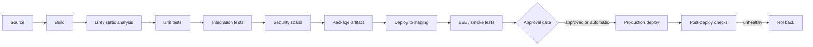

# CI/CD

Read this when a repo has a pipeline, or when you're asked to build or change one. Version control, lockfiles, and baselines are in `quality-and-process.md` (configuration management); this file covers the pipeline itself.

## Contents

1. [CI, delivery, deployment](#ci-delivery-and-deployment)
2. [Pipeline stages](#pipeline-stages)
3. [Design rules](#design-rules)
4. [Deployment strategies](#deployment-strategies)
5. [Database migrations](#database-migrations-in-a-pipeline)
6. [Working in a repo with CI](#working-in-a-repo-with-ci)
7. [Example: GitHub Actions test job](#example-github-actions-test-job)
8. [Pipeline metrics](#pipeline-metrics)
9. [Checklist](#checklist)

## CI, delivery, and deployment

| Term | Meaning | Human gate before production? |
|---|---|---|
| Continuous integration (CI) | Everyone merges small changes to the shared branch often; each change is built and tested automatically | n/a (stops at verified code) |
| Continuous delivery | Every change that passes the pipeline is packaged and could be released at any moment | Yes, a person presses the button |
| Continuous deployment | Every change that passes the pipeline goes to production automatically | No, the tests and checks are the gate |

Continuous deployment needs strong automated tests, fast rollback, and monitoring. Without them, stay at continuous delivery.

## Pipeline stages

| # | Stage | What it catches |
|---|---|---|
| 1 | Source (trigger on push, PR, tag, schedule) | nothing yet; decides what runs and on which commit |
| 2 | Build | compile errors, missing or conflicting dependencies, broken packaging |
| 3 | Lint / static analysis | style drift, type errors, likely bugs, dead code |
| 4 | Unit tests | logic regressions in single functions and classes |
| 5 | Integration tests | broken contracts between modules, DB queries, external APIs |
| 6 | Security scans (secrets, dependency CVEs, SAST, image scan) | leaked keys, vulnerable libraries, risky code patterns; see `security.md` |
| 7 | Package / artifact (versioned image or archive, pushed to a registry) | reproducibility: one immutable thing to promote |
| 8 | Deploy to staging | config, environment, and infra mistakes; migration failures |
| 9 | End-to-end / smoke tests on staging | broken user journeys, app that builds but doesn't start |
| 10 | Approval gate (delivery only) | business timing, change-window and compliance sign-off |
| 11 | Production deploy | n/a; uses a strategy from the table below |
| 12 | Post-deploy checks (smoke test, health, error rate, latency) | bad releases that passed staging; triggers rollback |



Stages 3, 4, and 6 are often independent and can run in parallel. Tests that need a running app (stage 9) come after a deploy.

## Design rules

| Rule | Why / how |
|---|---|
| Fail fast | Stop at the first failing stage and report which one; nobody waits on a doomed run |
| Cheap checks first | Lint and unit tests (seconds to minutes) before integration and e2e (minutes to hours) |
| Build once, promote the same artifact | The thing tested in staging must be byte-identical to what goes to production; never rebuild per environment. Differences live in config, not in the build |
| Pin versions | Lock dependencies (lockfile, `npm ci`), pin base images by tag or digest, pin third-party actions to a release or commit SHA, pin tool versions. Unpinned inputs make a green build irreproducible |
| Cache dependencies | Key the cache on the lockfile hash; a stale cache is worse than none, so include the tool version in the key |
| Parallelize | Split independent jobs and shard slow test suites; keep the critical path short |
| Keep main green | A broken main blocks everyone. Fix or revert first, feature work second. Require passing checks and review before merge (branch protection) |
| Secrets from the CI secret store | Never in the repo, logs, or image layers; mask them in output and don't echo env. Prefer short-lived tokens (OIDC federation) over long-lived keys |
| Least-privilege deploy credentials | Separate identities per environment; the test job needs no deploy rights; production credentials only on the production job, behind the gate |
| Flaky tests are bugs | Quarantine and fix, don't auto-retry until green (see `testing.md`) |

## Deployment strategies

| Strategy | How it works | Rollback | Watch out |
|---|---|---|---|
| Recreate | Stop the old version, start the new one | Redeploy the old artifact (downtime again) | Downtime; fine for internal tools or batch jobs |
| Rolling | Replace instances a few at a time | Roll forward or roll back the same way; slower, partial exposure | Old and new run side by side, so the API and DB must work with both |
| Blue-green | Run a full second environment, switch traffic when it passes checks | Switch traffic back to the still-running old environment (fast) | Double capacity; the DB is shared, so schema changes need care |
| Canary | Send a small share of traffic (1-5%) to the new version, widen as metrics hold | Route traffic back to the old version; most users never saw the bad build | Needs good metrics and automated judgment of "healthy" |
| Feature flags | Ship the code dark, turn it on per user group or percentage | Turn the flag off, no deploy | Remove stale flags; test both flag states |

Pair canary or blue-green with the reliability patterns in `reliability.md`. A deploy with no tested rollback path isn't ready for production.

## Database migrations in a pipeline

Application and schema can't change at the same instant, so assume old code meets the new schema and the reverse (design details in `database-design.md`).

- **Expand, then contract.** Release 1 adds the new column or table (nullable or defaulted), writes both, and backfills. Release 2 reads the new one. A later release drops the old. Each step is deployable and reversible alone.
- Migrations are versioned files in the repo, run by the pipeline (not by hand) before or alongside the app deploy, once per environment, and are idempotent or tracked by the migration tool.
- Apply them on staging first, against production-like data volume. A migration that locks a big table can take production down.
- Rolling back code is easy; rolling back data isn't. Write the down path or a restore plan, and take a backup before destructive steps.
- Don't run migrations against shared or production databases yourself unless the user asks; hand it off as a PR.

## Working in a repo with CI

1. **Find the CI config first**: `.github/workflows/`, `.gitlab-ci.yml`, `Jenkinsfile`, `.circleci/`, `azure-pipelines.yml`, `Makefile` targets. It is the source of truth for how the project builds, lints, and tests.
2. **Run the same commands locally** (same lint, type check, test, and build steps, with the same flags and versions where you can) before saying the work is done. A local pass on a different command is not a pass.
3. **Read the failing job's log before guessing.** Find the first error, not the last; later errors are often fallout. Reproduce locally. If it only fails in CI, look for version, environment variable, OS, or ordering differences.
4. **Never weaken or skip a check to get green**: no deleting or `skip`-ing tests, loosening thresholds or lint rules, adding `|| true`, or `--no-verify`. If a check is truly wrong, say so and let the user decide.
5. A change that adds a dependency, script, env var, or required tool also updates the CI config and docs.
6. Don't edit pipeline files casually: a workflow change can run with elevated permissions or secrets. Keep changes minimal and explain them.
7. Report what ran and where: "same commands as `ci.yml`: lint, test, build, all passed locally; not run: e2e (needs staging)".

## Example: GitHub Actions test job

A minimal generic job; swap the setup and commands for the project's stack.

```yaml
name: ci
on:
  pull_request:
  push:
    branches: [main]

permissions:
  contents: read

jobs:
  test:
    runs-on: ubuntu-latest
    timeout-minutes: 15
    steps:
      - uses: actions/checkout@v4
      - uses: actions/setup-node@v4
        with:
          node-version: 20
          cache: npm
      - run: npm ci
      - run: npm run lint
      - run: npm test
```

Pin actions to a commit SHA where the project's policy requires it. Read-only `permissions` is the least-privilege default; add more only to the job that needs it. This job only verifies; deployment belongs in a separate job with its own credentials.

## Pipeline metrics

These four (the DORA metrics) show whether the pipeline helps. More on measurement in `metrics.md`.

| Metric | Measures | Better means |
|---|---|---|
| Lead time for changes | commit to running in production | shorter |
| Deployment frequency | how often you release to production | higher (small, safe changes) |
| Change failure rate | share of deploys causing an incident, rollback, or hotfix | lower |
| Time to restore | from a failed release or incident to recovery | shorter |

Watch speed and stability together; deploying more often while failures climb is not progress. Also track pipeline duration and flaky-test rate when asked to improve the pipeline.

## Checklist

- [ ] CI config found and read; local runs use the same commands
- [ ] Stages ordered cheap to expensive; failures stop the pipeline early
- [ ] One build, one artifact, promoted unchanged through environments
- [ ] Dependencies, base images, and actions pinned; caches keyed on lockfiles
- [ ] Secrets come from the CI secret store; none in repo, logs, or images
- [ ] Deploy credentials are least-privilege and separate per environment
- [ ] Deployment strategy chosen, and the rollback is written down and tested
- [ ] Migrations are backward compatible (expand/contract) and run by the pipeline
- [ ] Post-deploy health check or smoke test exists
- [ ] No test, lint rule, or threshold weakened to get green
- [ ] Failing-job log read before changes; root cause fixed, not retried away
- [ ] Production deploy and shared-environment migrations left to the user unless asked
