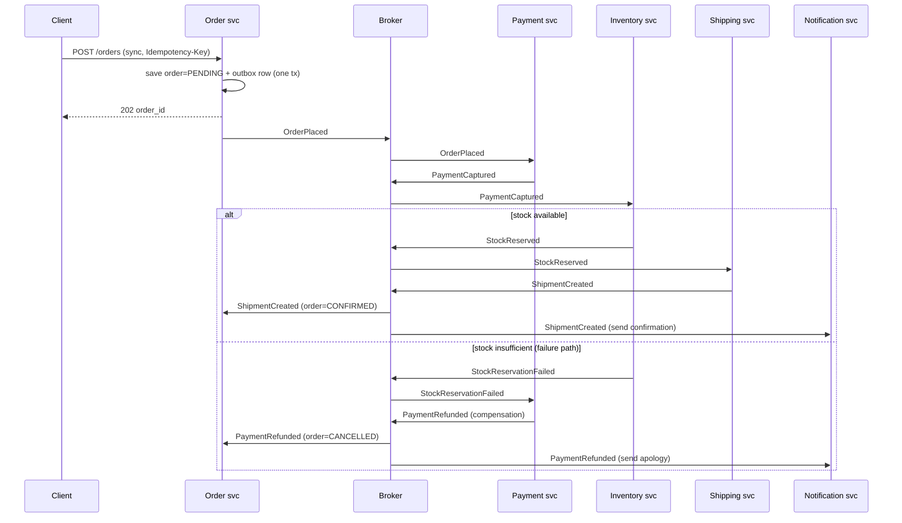

# Event-driven design

Use this when a design or change publishes/consumes events, adds a queue or topic, splits a workflow across services, or when someone says "just emit an event". For queue basics see `api-gateway-queues-rate-limits.md`; for style trade-offs see `architecture-styles.md`; for retries and timeouts in general see `fault-tolerance.md`; for ordering/consensus limits see `distributed-systems.md` and `availability-and-consistency.md`.

## Contents
1. Core pieces
2. Event-driven vs request-driven (decision table)
3. Message-driven vs event-driven (commands vs events)
4. Patterns and when to use each
5. Event sourcing vs event streaming
6. Event design rules
7. Delivery, ordering, idempotency
8. Error handling
9. Restoring state after a failure
10. Worked example: e-commerce order
11. Testing and observability
12. Review checklist

## 1. Core pieces

| Piece | Role | Check in code/design |
|---|---|---|
| Event | Record that something already happened (`OrderPlaced`) | Immutable, has id/type/time/version |
| Producer | Emits events, does not know who listens | No call to a consumer hidden behind the publish |
| Broker / log | Routes (queue, pub/sub) or stores (log) events | Retention, partitions, durability settings chosen on purpose |
| Topic / stream | Named channel of one kind of event | One owner per topic; naming and schema documented |
| Consumer | Reacts: updates data, calls something, emits more events | Idempotent; has its own failure path |
| Consumer group | Instances sharing one logical subscriber | Parallelism is bounded by partition count |

Gains: producer and consumer fail and scale separately, bursts get buffered, new consumers attach without touching the producer. Costs: eventual consistency, duplicates, ordering problems, harder debugging, a broker to operate. Pay these only when the gains matter.

## 2. Event-driven vs request-driven

| Situation | Choose | Why |
|---|---|---|
| Caller needs the answer to continue (login, payment authorization, price check) | Request-driven (sync call) | Result is part of the user's flow |
| Plain CRUD, one service, one DB | Request-driven | Events add cost with no gain |
| One action triggers several independent follow-ups (email, analytics, stock, shipping) | Event-driven | Producer stays ignorant of followers |
| Slow or bursty downstream work; delay is acceptable | Event-driven (queue) | Buffers load, keeps API fast |
| Need audit history or rebuildable read models | Event log / event sourcing | See section 5 |
| Need strict, immediate cross-entity consistency | Request-driven + one transaction | Eventual consistency won't do |
| Third party must be notified of changes | Events or webhooks, with retries and signing | Their uptime isn't yours |

Most systems mix both: sync for "I need an answer now", events for "tell whoever cares". Events do not remove coupling, they move it: consumers still depend on the event schema and on the broker.

Event-driven is a communication style; microservices are a deployment and ownership split. You can have either without the other (a monolith can publish internal events; microservices can call each other over HTTP).

## 3. Message-driven vs event-driven

| | Command message | Event |
|---|---|---|
| Meaning | "Do this" | "This happened" |
| Name | Imperative: `ChargePayment` | Past tense: `PaymentCaptured` |
| Receivers | One intended handler | Zero to many, unknown to sender |
| Sender expects | An action (and often a result) | Nothing |
| Can be rejected | Yes | No, it is already a fact |
| Typical transport | Queue addressed to a worker | Topic / log |

"Message-driven" is the broader term: a message can carry a command, a request, data, or an event. Rule of thumb: if the sender cares that something specific happens next, it is a command; send it to one queue and treat failure as the sender's problem. If the sender is just reporting a fact, publish an event. Disguising commands as events (`SendWelcomeEmailRequested` fanned out to everyone) recreates tight coupling with extra steps.

## 4. Patterns and when to use each

| Pattern | What | Use when | Watch out for |
|---|---|---|---|
| Event notification | Small event "X changed, id=42"; consumers call back for details | Few fields, many unknown consumers, data owner must stay authoritative | Callback storm; consumer needs producer up |
| Event-carried state transfer | Event carries the data consumers need; they keep a local copy | Consumers must work when producer is down; avoid chatty reads | Stale copies; payload growth; PII spreading |
| Event sourcing | Store events as the source of truth; derive state by replay | Audit trail, temporal queries, rebuildable views | Schema evolution, replay cost, complexity (section 5) |
| CQRS | Separate write model from read models | Read and write loads/shapes differ a lot | Read side lags; do not use for simple CRUD. Works with or without event sourcing |
| Saga | Multi-service process as local steps + compensations | Business transaction spans services, no shared DB transaction | Compensation must be designed and tested; partial states visible |
| Transactional outbox | Write event to an outbox table in the same DB transaction as the data; a relay publishes it | Any "update DB and publish" that must not lose or invent events | Relay lag; relay duplicates (consumers must dedupe) |
| Competing consumers | Several workers pull from one queue; each message goes to one | Scale work, absorb bursts | No ordering across workers unless partitioned by key |
| Pub/sub | Every subscriber gets each event | Several services react to the same fact | Each subscriber needs its own queue/offset |
| Streaming | Durable log; consumers read at own pace and can replay | Analytics, pipelines, many consumers, reprocessing | Retention cost; consumer lag; partition design |

**Saga: choreography vs orchestration**

| | Choreography | Orchestration |
|---|---|---|
| Control | Each service reacts to others' events | A coordinator tells services what to do next |
| Good for | 2-4 steps, few services | Longer flows, branching, timeouts, need one place to see state |
| Weakness | Flow is implicit; hard to trace and change | Coordinator is more code and a dependency |
| Failure | Services emit failure events others react to | Coordinator runs the compensations |

Start with choreography for short flows; move to orchestration when you cannot draw the flow from memory.

**The dual-write trap.** Code that does `db.save(); broker.publish()` can crash between the two and lose the event, or publish then fail the save. Use the outbox, or publish only from the log you already write to (change data capture). Review any handler that writes to two systems.

## 5. Event sourcing vs event streaming

| | Event sourcing | Event streaming |
|---|---|---|
| Purpose | Persist state changes; current state = replay of events | Move and process events between systems |
| Source of truth | The event history | Depends on architecture (often another DB) |
| Retention | Kept for the life of the entity | Configurable, often time- or size-bound |
| Replay | Rebuild an aggregate or projection | Reprocess retained data in a consumer |
| Recovery | Snapshot + later events | Offset/checkpoint + retained events |
| Typical tools | Event store, or an append-only table | Kafka, Pulsar, Kinesis |
| Fits | Ledgers, order lifecycle, audit-heavy domains | Real-time analytics, pipelines, integration, IoT |

They combine well (event-sourced service publishing to a stream) but are independent. Do not adopt event sourcing just because you adopted Kafka.

If you do event source: validate commands against the aggregate, then append events; use optimistic concurrency (expected version) on append; snapshot every N events; never re-trigger external side effects (emails, charges) during replay; plan for how old event versions are upcast; projections are eventually consistent, so tell the UI.

## 6. Event design rules

- **Name in past tense, domain language:** `OrderPlaced`, not `CreateOrder` or `OrderEvent`.
- **Immutable.** Fix mistakes with a new event (`OrderCorrected`), never by editing history.
- **Envelope fields:** `event_id` (unique, used for dedupe), `type`, `schema_version`, `occurred_at` (when it happened, UTC), `producer`, `correlation_id` (ties a whole business flow together), `causation_id` (the event/command that caused this one), and an aggregate/entity id.
- **Versioned schema** in a registry or repo (JSON Schema, Avro, Protobuf). Evolve compatibly: add optional fields, never rename or retype; run compatibility checks in CI. Breaking change = new event type or new topic version, with both live during migration.
- **Payload size:** include what most consumers need to act without calling back (ids, amounts, status, key attributes), not the whole entity graph. Large blobs go to storage with a reference.
- **Sensitive data:** keep PII and secrets out unless a consumer truly needs it; events are copied, retained, and replayed.
- **Money:** integer minor units plus currency code.
- **One fact per event.** An event describing three changes is a hidden command.
- **Partition key** is part of the design: usually the aggregate id (`order_id`).

Example envelope:
```json
{"event_id":"0b1f...","type":"OrderPlaced","schema_version":2,
 "occurred_at":"2026-11-14T09:30:00Z","correlation_id":"c-77",
 "order_id":"o-1001","customer_id":"u-9","total_minor":4599,"currency":"USD"}
```

## 7. Delivery, ordering, idempotency

| Semantics | Meaning | Reality |
|---|---|---|
| At-most-once | Sent once, may be lost | Cheap; only for lossy data (metrics) |
| At-least-once | Retried until acked; may duplicate | The usual default; pair with idempotent consumers |
| Exactly-once | Effect happens once | Only within a bounded system (e.g. broker transactions + its own state). End to end, you get it by at-least-once + idempotency |

- **Ack after the work is durably done**, not on receipt. Acking early loses events on a crash; acking late causes duplicates, which idempotency handles.
- **Ordering** is guaranteed per partition (or per queue with one consumer), rarely globally. Pick the partition key so events that must stay ordered share it (all events of one order). Consequences: hot keys, and parallelism capped by partitions. Retries can reorder events; don't rely on arrival order across keys.
- **Idempotent consumer techniques:** store processed `event_id` in the same transaction as the side effect (unique constraint); use natural idempotency (set status = X rather than increment); use an idempotency key on outgoing calls (e.g. to the payment provider); compare version numbers and ignore stale events.
- **Dedupe store** needs a retention window longer than the broker's max redelivery/replay window.

## 8. Error handling

| Failure | Do | Don't |
|---|---|---|
| Transient (timeout, 5xx, lock) | Retry with exponential backoff + jitter, capped attempts | Retry instantly in a tight loop; block the partition forever |
| Permanent (bad data, schema mismatch, business rule) | Send to dead-letter queue (DLQ) with error and original headers | Retry; drop silently |
| Poison message (crashes the consumer every time) | Cap attempts, then DLQ; keep the partition moving | Let one message stall everything behind it |
| Duplicate | Dedupe by event_id | Assume the broker prevents it |
| Out-of-order | Version check; park or ignore stale events | Overwrite newer state with older |
| Downstream slow/down | Timeout, circuit breaker, pause consumption, backpressure | Unbounded in-memory buffering |
| Multi-step process failed midway | Compensation (saga) | Leave half-done state with no owner |
| Step never answers | Timeout in the saga, then compensate or escalate | Wait indefinitely |

Details that bite:
- A DLQ is useless unless someone watches it: alert on depth/age, keep a replay tool, and make replay safe (idempotent consumers).
- Retry tiers (retry-1m, retry-10m, then DLQ) avoid blocking the main topic when order is not critical. When per-key order matters, retry in place with a cap, or park that key.
- Compensation is a new business action, not a rollback: refund, release stock, cancel shipment. It can fail too, so it needs retries and an alert. Some steps cannot be undone (email sent): put them last.
- Distinguish failure events from exceptions: `PaymentFailed` is a normal event consumers handle.

## 9. Restoring state after a failure

| Need | Mechanism | Notes |
|---|---|---|
| Consumer crashed, resume | Committed offset / checkpoint | Commit after processing; reprocessed tail must be idempotent |
| Consumer's read model is wrong or lost | Replay from log (reset offset, or rebuild projection) into a new store, then switch | Needs enough retention; disable external side effects on replay |
| Replay is too slow | Snapshots of state every N events/minutes | Replay only events after the snapshot; snapshot is a cache, events stay truth |
| Long-running job/stream processor | State checkpointing | Restore state and offset together |
| Event lost between DB write and publish | Transactional outbox | Relay retries until published |
| Broker/node failure | Replicated topics/queues, durable storage, acks from replicas | Set replication factor and min in-sync acks deliberately |
| Saga interrupted mid-flow | Persist saga state; resume or compensate on restart | Keep saga state in a DB, not memory |
| Event consumed but side effect unknown | Reconcile against the external system by idempotency key | Prefer lookup over blind retry for payments |

Recovery runbook questions for the design doc: How far back can we replay? How long does a full rebuild take? What happens to events produced while rebuilding? Who owns the DLQ?

## 10. Worked example: e-commerce order

Services: Order, Payment, Inventory, Shipping, Notification. Choreography; each service has an outbox. The failure path: stock is short after payment succeeded, so payment is refunded.



Design notes:
- The client call is request-driven (accept, return id); the rest is events. The UI polls or subscribes for order status.
- Every event carries `order_id` as partition key and one `correlation_id`.
- Each consumer records processed `event_id`; refunds use the order id as the provider idempotency key.
- Payment timeout: if no `PaymentCaptured` or `PaymentFailed` within N minutes, Order cancels the order (a timer, or an orchestrator).
- Stock reserved but shipping fails: Shipping emits `ShipmentFailed`; Inventory releases, Payment refunds. Draw every such branch in the design.
- If the flow grows (fraud check, split shipments), move to an orchestrator.

## 11. Testing and observability

Test:
- **Contract/schema:** producer output validates against the registry; consumers still parse the previous and next version.
- **Consumer unit tests:** feed the same event twice, events out of order, a malformed event, a missing optional field; assert effects happen once.
- **Failure injection:** consumer throws after side effect but before ack; broker restart; downstream timeout; assert retry, DLQ, no lost event.
- **Outbox:** crash between commit and publish; assert event still goes out.
- **Saga:** each step failing in turn ends in a consistent state (see `testing.md` for levels).
- **Replay:** rebuild a projection from the log and compare with the live one.
- **Integration with a real broker** (container) for at least one happy and one failure path; mocks hide ordering and ack behavior.
- Async assertions: poll with timeout, never fixed sleeps.

Observe:
- Propagate `correlation_id` through logs, spans, and event headers; trace across the broker.
- Metrics: consumer lag, queue/partition depth, processing latency (event time to handled time), error and retry rate, DLQ depth and oldest age, saga stuck count.
- Alerts on lag growth and DLQ age, not just errors.
- A way to look up "everything that happened to order X" by correlation id.

## 12. Review checklist

- [ ] Is events the right tool here, or would a sync call or a plain function do?
- [ ] Commands vs events separated; events named in past tense, one fact each.
- [ ] Envelope has id, type, version, time, correlation id; schema is versioned and compatibility-checked.
- [ ] Payload sized deliberately; no needless PII.
- [ ] No dual write: outbox or equivalent for "save and publish".
- [ ] Delivery assumed at-least-once; every consumer idempotent with a stated dedupe mechanism.
- [ ] Partition key chosen; ordering needs identified; no reliance on global order.
- [ ] Ack happens after durable processing.
- [ ] Retries are capped with backoff and jitter; DLQ exists, is monitored, and replay is safe.
- [ ] Multi-service flows have compensation, timeouts, and persisted saga state; every failure branch is drawn.
- [ ] Side effects are not re-fired on replay; replay and snapshot strategy documented if events are the source of truth.
- [ ] Eventual consistency is acknowledged in the API/UI (status field, 202, polling).
- [ ] Consumer lag, DLQ depth, and correlation tracing are in place.
- [ ] Tests cover duplicate, out-of-order, poison, crash-before-ack, and schema change.
