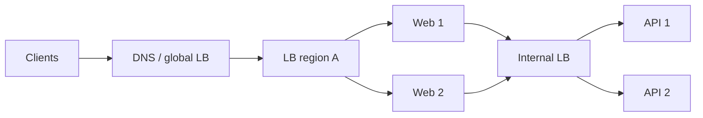

# Load balancing, failover, consistent hashing, concurrency

## Contents
1. What a load balancer does and where it sits
2. Types — pick one
3. Algorithms
4. Stateless vs stateful, session persistence
5. Operational must-haves (health checks, draining, TLS, no SPOF)
6. Load balancing vs failover
7. Consistent hashing (with a tested sketch)
8. Concurrency vs parallelism in code
9. Checklist

Related: `scalability.md`, `availability-and-consistency.md`, `caching.md`, `architecture-styles.md` (stateless vs stateful services), `api-gateway-queues-rate-limits.md`, `networking.md` (DNS, proxies), `database-design.md` (sharding).

## 1. What a load balancer does and where it sits

It accepts traffic on one address and spreads it over a pool of identical backends, skipping unhealthy ones. You get horizontal scaling, no single overloaded node, and the ability to take a node out without downtime. It also needs to be reachable, so it is itself something to make redundant (section 5).



Put one in front of every tier that has more than one instance (web to API, API to cache or DB read replicas), not only at the edge. In design docs, draw each LB and say its layer, algorithm, and health check.

## 2. Types — pick one

Two independent axes: where it runs, and which layer it reads.

| Type | Use when | Trade-off |
|---|---|---|
| Layer 4 (TCP/UDP: IP, port) | High connection volume, non-HTTP protocols, no need to read content | Cannot route by path, header, or cookie |
| Layer 7 (HTTP: path, host, header, cookie) | Route to different services, canary by header, TLS termination, cookie stickiness | More CPU per request; it parses traffic |
| Hardware appliance | Own data centre, very high throughput, vendor support | Costly, slow to change, capacity bought up front |
| Software (NGINX, HAProxy, Envoy) | Flexible, cheap, config in version control, runs anywhere | You operate, patch, and scale it |
| Cloud-managed | Workload already in that cloud; want autoscaling and built-in health checks | Provider-specific limits and behaviour; ongoing cost |
| DNS / global (GSLB) | Users in several regions, regional failover, latency or geo routing | DNS caching delays changes; coarse-grained, no per-request awareness |

Typical shape: DNS or global LB picks a region, an L7 LB picks a service, an L4 LB or service mesh balances internal traffic. Cloud products often offer both L4 and L7 variants, so decide the layer first, the product second.

## 3. Algorithms

| Algorithm | Kind | Fits | Weakness |
|---|---|---|---|
| Round robin | static | Similar servers, similar request cost | Blind to load; slow requests pile up on one node |
| Weighted round robin | static | Mixed server sizes, gradual rollouts (small weight for new version) | Weights are manual; don't react to live load |
| Random | static | Many LBs with no shared state; trivial to implement | Uneven in the short run |
| IP / source hash | static | Cheap affinity without cookies | Users behind one NAT hit one node; pool changes remap many clients |
| Least connections | dynamic | Requests vary widely in duration (uploads, websockets) | Needs live counts; connection count is not CPU or memory |
| Weighted least connections | dynamic | Varied durations and varied server sizes | Same, plus weights to maintain |
| Least response time | dynamic | Latency-sensitive services | Needs constant measurement; one latency spike skews choices |
| Power of two choices | dynamic | Many LBs each with a partial view; pick 2 random nodes, send to the less loaded | Still needs a load signal; stale signals hurt |
| Consistent hash (key) | static | Same key must reach same node: caches, shards (section 7) | Hot keys overload one node |

Default: round robin for uniform stateless work, least connections once request duration varies. Pick key-based hashing only when locality matters. Resource-based balancing (CPU, queue depth) works if metrics are fresh; stale metrics route badly.

## 4. Stateless vs stateful, session persistence

"Stateless" LB: each request is routed on its own. "Stateful" LB: it remembers client-to-backend affinity (session persistence).

| Option | How | Cost |
|---|---|---|
| Externalize session state (preferred) | Sessions in Redis/DB, or signed tokens (JWT) the client carries; any node can serve any request | Extra lookup per request; the store must be available |
| Sticky sessions | LB sets a cookie or hashes source IP to pin a client to a node | Uneven load; node loss drops its sessions; scale-in is awkward; hides state bugs |

Use stickiness only as a stopgap for a legacy app with in-memory sessions, or where state is inherently connection-bound (websockets, long uploads). Even then, a node dying must be survivable: client re-authenticates or state is rebuilt. Code check: grep for in-process session maps, local-disk uploads, and per-instance counters; each breaks when a second node appears. See `architecture-styles.md`.

## 5. Operational must-haves

- **Health checks.** Active: LB polls a `/health` endpoint on an interval. Passive: it ejects nodes that return errors or time out on real traffic. Use both. Set thresholds (for example 3 failures out, 2 successes back in) to avoid flapping.
- **Liveness vs readiness.** Liveness says the process is up; readiness says it can take traffic (DB connected, caches warm). The LB should use readiness. Do not make the health check call every dependency, or one shared DB blip ejects the whole pool.
- **Connection draining.** Before deploy or scale-in, mark the node out of rotation, let in-flight requests finish (timeout around your longest normal request), then stop. App side: handle SIGTERM by finishing work, not dying.
- **TLS termination.** Terminating at the LB centralises certificates and offloads CPU; traffic behind it is plain unless you re-encrypt. Re-encrypt or use mTLS when the internal network is not trusted or compliance requires it. Forward the client IP (`X-Forwarded-For` / PROXY protocol) and trust it only from the LB.
- **No single point of failure.** Run at least two LB instances (active-active, or active-passive with a shared virtual IP and heartbeat), spread across zones, or use a managed LB that already does this. Avoid putting all state in one LB's memory.
- **Limits and timeouts.** Set idle, connect, and request timeouts and a retry policy (only retry idempotent requests; see `fault-tolerance.md`). Cap max connections per backend.

## 6. Load balancing vs failover

| | Load balancing | Failover |
|---|---|---|
| Goal | Performance, capacity, even use | Availability when something dies |
| Normal operation | All nodes serve traffic | Standby idle (or lightly used) |
| Trigger | Every request | A detected failure |
| Typical shapes | Pool of equals | Active-passive pair, replica promotion |
| Cost | Pay for capacity you use | Pay for idle spare capacity |
| Risk | Overload cascade if one node's share shifts onto fewer nodes | Detection delay, brief interruption, split brain if two nodes think they are primary |

They combine: the LB is the failover mechanism for stateless tiers (health check removes a node, others absorb its load), so size the pool with N+1 headroom. For stateful pieces (a primary DB), failover is promotion of a replica plus repointing clients, and the LB or a proxy can hide that switch. Deeper treatment: `availability-and-consistency.md`. Check in code and docs: what happens to in-flight requests during a switch, how long detection takes, and whether failover was ever tested.

## 7. Consistent hashing

Problem: `hash(key) % N` remaps nearly every key when N changes, which empties a cache or forces mass data movement. Consistent hashing fixes this.

- **Ring.** Hash servers and keys into the same circular space. A key belongs to the first server clockwise from it.
- **Virtual nodes.** Each server takes many ring positions (typically 50-200). This evens out load and lets a bigger server take more positions. Too few vnodes means lumpy distribution.
- **Movement.** When a node joins or leaves, only about K/N of K keys move (roughly one Nth, where N is the node count): a leaver's keys go to its clockwise neighbours; a joiner takes keys from them. Everything else stays.
- **Where used.** Distributed caches, sharded databases (see `database-design.md`), partitioned queues and logs, request affinity routing.
- **Limits.** It does not replicate data (add replication on the next nodes), and a hot key still overloads one node. Use a stable hash such as MD5 or xxHash; language built-in hashes may be salted per process.

Sketch. With 5 nodes, removing one moves roughly a fifth of the keys, all of them from the removed node:

```python
import bisect, hashlib

class HashRing:
    def __init__(self, nodes=(), vnodes=100):
        self.vnodes = vnodes
        self._ring = []    # sorted ring positions
        self._owner = {}   # position -> node
        for n in nodes:
            self.add(n)

    @staticmethod
    def _h(s):  # md5, not hash(): hash() is salted per process
        return int.from_bytes(hashlib.md5(s.encode()).digest()[:8], "big")

    def add(self, node):
        for i in range(self.vnodes):
            h = self._h(f"{node}#{i}")
            if h not in self._owner:
                bisect.insort(self._ring, h)
                self._owner[h] = node

    def remove(self, node):
        for i in range(self.vnodes):
            h = self._h(f"{node}#{i}")
            if self._owner.get(h) == node:
                del self._owner[h]
                self._ring.pop(bisect.bisect_left(self._ring, h))

    def get(self, key):  # first position clockwise from the key, wrapping
        i = bisect.bisect(self._ring, self._h(key)) % len(self._ring)
        return self._owner[self._ring[i]]
```

Test it: map 10,000 keys, remove a node, assert every moved key used to belong to that node and the moved share is well under 100%.

## 8. Concurrency vs parallelism in code

| | Concurrency | Parallelism |
|---|---|---|
| Idea | Several tasks in progress, interleaved | Several tasks executing at the same instant |
| Needs | One core is enough | Multiple cores or machines |
| Helps | Responsiveness, waiting on I/O | Throughput on heavy computation |
| Main hazard | Races, deadlocks on shared state | Same, plus coordination overhead and serial portions limiting speedup |

Choosing a model:

| Workload | Use | Why |
|---|---|---|
| I/O-bound, many connections (HTTP calls, DB, sockets) | Async/await or an event loop | Cheap tasks; no thread per wait |
| I/O-bound, blocking libraries | Thread pool | Threads wait without burning CPU |
| CPU-bound | Processes, native extensions, or worker machines | In CPython, threads share one interpreter lock, so CPU work does not speed up; other runtimes' threads do run in parallel |
| Scale beyond one machine | Queue plus workers | See `api-gateway-queues-rate-limits.md` |

Code review checks:
- Identify whether a hot path is CPU- or I/O-bound by measuring, not guessing.
- Shared mutable state needs a lock, an atomic operation, a queue, or no sharing at all (prefer passing messages or immutable data). Read-modify-write on a counter or "check then insert" is a race; push it into the database (unique constraint, atomic update) when it spans instances.
- Keep lock scope small, take locks in a consistent order, never call blocking code inside an async function (it stalls the whole loop).
- Bound everything: pool sizes, queue lengths, concurrent requests to a dependency. Unbounded fan-out is how one slow service takes down its caller.
- Instance-local locks do not protect against other instances behind the LB; use DB constraints, optimistic versioning, or a distributed lock with expiry.
- A speedup claim needs a benchmark; coordination and serial parts cap gains.

## 9. Checklist

- [ ] Every multi-instance tier has an LB (or client-side balancing) named in the diagram, with layer and algorithm.
- [ ] Layer 4 vs 7 chosen for a reason (path routing, TLS, protocol).
- [ ] Algorithm fits request shape; weights or slow-start for mixed or new nodes.
- [ ] Services are stateless, or stickiness is a documented stopgap with a failure plan.
- [ ] Health checks are readiness-based, with thresholds, and do not cascade on a shared dependency.
- [ ] Connection draining and SIGTERM handling in place for deploys.
- [ ] TLS termination point decided; client IP forwarded and trusted only from the LB.
- [ ] The LB is redundant across zones; failover tested, not assumed.
- [ ] Pool sized N+1 so losing a node does not overload the rest.
- [ ] Key-based routing (caches, shards) uses consistent hashing with vnodes and a stable hash; hot keys considered.
- [ ] Concurrency model matches workload (I/O vs CPU); shared state protected; pools and queues bounded.
- [ ] Races across instances handled in the datastore, not just with in-process locks.
