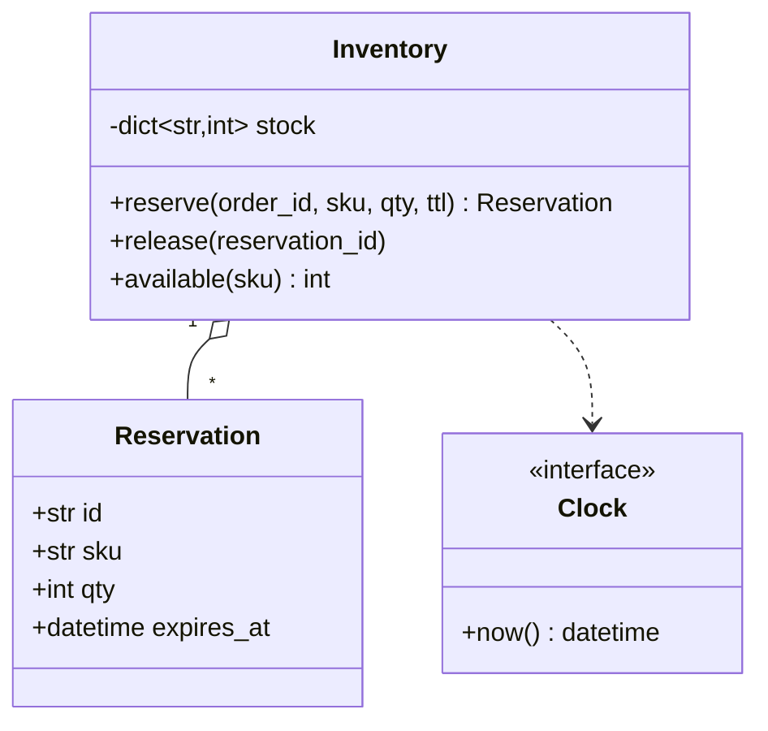
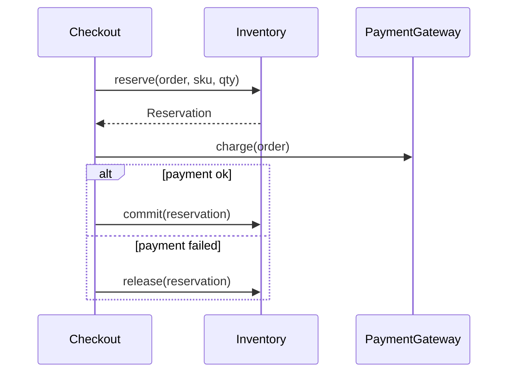
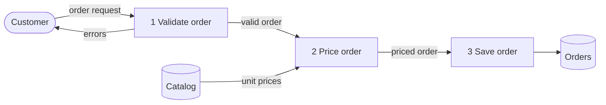

# Low-level design

LLD turns a component from the high-level design (or a medium-sized feature) into classes, interfaces, methods, data structures, and their interactions — concrete enough to implement directly.

## Contents

- [Design process levels](#design-process-levels)
- [HLD → LLD steps](#hld--lld-steps)
- [Core design principles](#core-design-principles)
- [OO principles](#oo-principles)
- [Coupling and cohesion](#coupling-and-cohesion)
- [Function-oriented vs object-oriented design](#function-oriented-vs-object-oriented-design)
- [Patterns](#patterns--reach-for-one-only-when-its-problem-is-present)
- [UML in Mermaid](#uml-in-mermaid)
- [UI design](#ui-design)
- [LLD checklist](#lld-checklist)

## Design process levels

Design moves from coarse to fine. Each level fixes decisions the next one builds on; a problem found lower down is a reason to revisit the level above, not to work around it.

| Level | Answers | Produces | Maps to |
|---|---|---|---|
| Architectural | What are the major parts and how do they talk? | Subsystems/services, their responsibilities, protocols between them, quality targets (scale, latency, reliability) | The HLD (input to step 1) |
| High-level (preliminary) | How does each part split into modules, and what crosses each module boundary? | Module/class list, module interfaces, shared data shapes, a structure chart or class diagram | Steps 2, 3, 5 |
| Detailed | What is inside each module? | Signatures, attributes, algorithms, data structures, state transitions, error handling | Steps 4, 6, 7, 8 |

Interface design (the system seen as a black box: which events and messages come in and go out, their formats, ordering, and timing) cuts across all three. Pin it down early for anything external: public APIs, UI, files, devices.

Scale the depth to the change: a bug fix may need only the detailed level; a new service needs all three.

## HLD → LLD steps

1. Start from the FRs, business rules, constraints, and the HLD decisions that affect this component.
2. Identify core entities (nouns in the requirements) and give each one responsibility. For data-flow-shaped work, identify the top-level functions and the data passed between them instead (see [function-oriented design](#function-oriented-vs-object-oriented-design)).
3. Put interfaces only where behavior genuinely varies (multiple payment providers, pluggable strategies) — not "just in case".
4. Define attributes, methods, and visibility for each class.
5. Define relationships: association, aggregation, composition, inheritance (only for true "is-a").
6. Choose data structures for the hot paths (map for lookup by key, heap for priority, etc.).
7. Walk the main flows and error paths; add a sequence diagram for any flow with 3+ participants.
8. Plan validation and error handling: what can fail, who detects it, what the caller sees.
9. Review against the principles below, plus testability and edge cases.

Steps 2–7 are the object-oriented design loop: find objects → assign responsibilities → decide who collaborates with whom (which messages flow) → shape classes and relationships → refine with diagrams. Repeat until each class can be coded without further design questions.

## Core design principles

| Principle | In practice |
|---|---|
| Abstraction | Name a concept by what it does; callers use the *what* and never depend on the *how*. Applies to functions (procedural) and types (data). |
| Stepwise refinement | Start with a one-line statement of the job, then expand each part one level at a time. The mirror image of abstraction. |
| Modularity | Split into units that can be read, tested, and replaced alone. Too few means tangled; too many tiny ones means glue code everywhere. |
| Information hiding | Each module owns one decision likely to change (data format, algorithm, vendor) and hides it behind a narrow interface. |
| Separation of concerns | Keep I/O, business rules, persistence, and presentation in different places so each can change alone. |
| Functional independence | High cohesion inside, low coupling between — see the tables below. |
| Traceability | Every design element traces to a requirement, and every requirement lands somewhere in the design. |
| Reuse first | Check the codebase, stdlib, and installed deps before designing something new. |
| Small intellectual distance | Mirror the problem domain's names and structure so the code reads like the problem. |
| Uniformity | Same conventions, error style, and naming across the design; new parts fit the existing ones. |
| Design for change | Isolate the parts the requirements say will vary; leave the rest simple. |
| Degrade gracefully | On a failure, keep working at reduced capacity (cached data, retry later, partial result) rather than crash or corrupt. |
| Review the design | Look at alternatives and wider effects before coding; a design error is far cheaper to fix than a shipped one. |

## OO principles

**OOP**: encapsulation (hide state behind behavior), abstraction (expose what callers need), inheritance (sparingly), polymorphism (vary behavior behind one interface).

**SOLID**
- **S**ingle responsibility — one reason to change.
- **O**pen/closed — add behavior by adding code, not editing stable code (when variation is real).
- **L**iskov substitution — a subtype works anywhere its base type does.
- **I**nterface segregation — small, focused interfaces.
- **D**ependency inversion — depend on abstractions at boundaries (DB, network, clock) so you can test with fakes.

**Also**: DRY (but tolerate a little duplication over a bad abstraction), KISS, YAGNI, composition over inheritance, low coupling / high cohesion.

**OO anti-patterns to spot**: God object (one class knows and does everything), spaghetti code (no clear structure or flow), lava flow (dead or half-finished code nobody dares remove), object orgy (objects reach freely into each other's internals).

## Coupling and cohesion

Coupling is how much modules depend on each other; cohesion is how strongly the parts of one module belong together. Aim for the top rows of both tables.

**Coupling, best → worst**

| Type | Looks like | When you spot it |
|---|---|---|
| Data | `total = line_total(qty, unit_price)` — only the values needed | Keep it. |
| Stamp | `send_receipt(order)` but only `order.email` is read | Pass the fields, or a narrow type; fine when the whole record is the natural unit. |
| Control | `render(report, as_pdf=True)` — a flag picks the callee's branch | Split into `render_pdf` / `render_html`, or pass a strategy. |
| External | Two modules each parse the vendor's CSV layout or wire format | Put one adapter in front of the external format; everyone else uses it. |
| Common | Modules read and write a global `CONFIG` dict or module-level mutable state | Pass the values in, or inject a config object at the composition root. |
| Content | `cart._items.append(x)` from outside, or monkeypatching another module | Add or use a public method; never edit another module's internals. |

**Cohesion, best → worst**

| Type | Looks like | When you spot it |
|---|---|---|
| Functional | `parse_iso_date(s)` — every line serves one task | Keep it. |
| Sequential | `load → clean → aggregate`, each step's output feeds the next | Fine; split a step out if others need it alone. |
| Communicational | `CustomerSummary` functions all work on the same customer record | Fine while small; split by purpose if it grows. |
| Procedural | `checkout()` validates the cart, then logs analytics, then sends a newsletter | Keep the core steps; move unrelated ones behind an event or caller. |
| Temporal | `startup()` opens DB, warms cache, sets up logging, loads flags | OK at the composition root; keep it a thin list of calls into owning modules. |
| Logical | `handle(kind, payload)` with `if kind == "email" … elif kind == "sms"` | Split into one function per kind, or polymorphism / a dispatch map. |
| Coincidental | `utils.py` holding `format_price`, `retry`, `slugify` | Move each function next to its domain or callers. |

## Function-oriented vs object-oriented design

**Function-oriented design (FOD)** sees the system as functions that transform data. State lives in the data passed between them, not inside objects.

- **Top-down decomposition**: state the whole job as one function, split it into sub-functions, repeat until each leaf is small enough to code. Watch for leaves that several branches need and make them shared, reusable functions instead of copies.
- **Data flow diagram (DFD)**: processes (transformations), data stores, external entities, and labeled flows between them. Draw a context level first (whole system as one process), then expand each process a level at a time. Shows *what* data moves, not control order.
- **Structure chart**: the module call hierarchy. Each box is a black-box module; arrows show calls and the data passed down and results returned. Modules play roles: input, output, transform, or coordinator.
- **Data dictionary**: one definition per data item in the DFD: name, aliases, type/structure, valid range, where used. In code this is your typed records or schema (dataclasses, TypedDict, Pydantic, protobuf, SQL DDL).
- **Pseudocode**: short structured English for each leaf function when the logic is non-obvious.

| Prefer FOD when | Prefer OOD when |
|---|---|
| Data pipelines, ETL, batch jobs, ML preprocessing | Long-lived entities with state and invariants (orders, accounts, sessions) |
| CLI tools and scripts | Many variants of one behavior chosen at runtime |
| Stateless request handlers, compilers' pass structure | GUIs, simulations, games, rich domain models |
| Functional codebases (Elixir, Haskell, Clojure) or plain-function Go/C | Codebases already organized around classes |

Mixing is normal: a functional core (pure transforms) with a thin imperative or OO shell for I/O, or an OO domain whose methods use small function pipelines internally. Follow what the codebase already does.

## Patterns — reach for one only when its problem is present

| Problem | Pattern |
|---|---|
| Several interchangeable algorithms/policies | Strategy |
| Creating one of several related types from input | Factory (often just a function/dict) |
| Complex object with many optional parts | Builder (or keyword args / dataclass) |
| Notify many listeners of state changes | Observer / pub-sub |
| Object behavior depends on a finite state set | State machine (explicit enum + transitions) |
| Adapt a third-party API to your interface | Adapter |
| Add cross-cutting behavior (logging, retry, caching) | Decorator / middleware |
| Undo/redo, queued operations | Command |
| Single shared instance | Usually dependency injection instead of Singleton |

Overusing patterns is a common LLD failure: three classes and an interface for something a function could do.

## UML in Mermaid

Class diagram:

Sequence diagram:

Also useful: state diagrams (`stateDiagram-v2`) for entities with lifecycles (order: created → paid → shipped → delivered / cancelled).

Data flow diagram (for function-oriented designs) as a flowchart — rounded = external entity, box = process, cylinder = data store:

## UI design

If the change touches a screen, form, dashboard, or CLI, read `ui-design.md` (layout and visual hierarchy, density limits, interaction and accessibility checklist).

## LLD checklist

- [ ] Design depth matches the change (architectural / high-level / detailed as needed)
- [ ] Paradigm fits the problem: functions and data flow for pipelines and scripts, objects for stateful entities
- [ ] Every class or module has one clear responsibility (functional or sequential cohesion; no `utils` grab-bags)
- [ ] Coupling is data-level where possible: no shared globals, control flags, or reaching into internals
- [ ] Each module hides a decision likely to change behind a narrow interface
- [ ] Interfaces exist only where variation is real or for testing a boundary
- [ ] Relationships are composition-first; inheritance only for true "is-a"
- [ ] Main flows and error paths walked through; failures degrade gracefully
- [ ] Concurrency considered where shared state is mutated
- [ ] Input validation and error handling placed at boundaries
- [ ] Design is testable (time, randomness, I/O injectable)
- [ ] Every element traces to a requirement; nothing added "for later"
- [ ] If UI changed: checklists in `ui-design.md` passed
