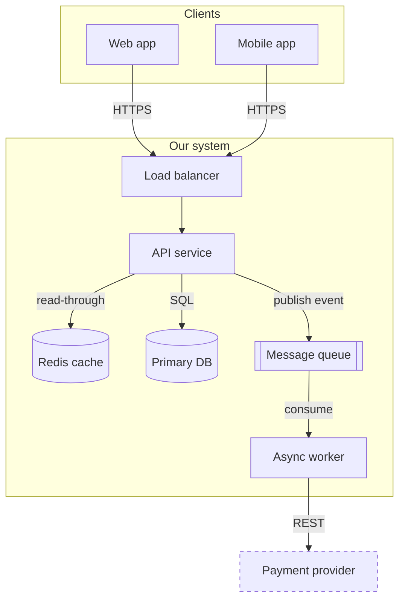

# System design (high-level design)

## Contents
1. Process
2. Estimation cheatsheet
3. Building blocks — when to reach for each
4. Trade-offs
5. HLD diagram rules
6. Design-doc template
7. Deep-dive reference files — which file to open for which decision

## 1. Process

1. **Clarify requirements** — FRs, NFRs with numbers, out of scope (see `requirements.md`).
2. **Estimate** — traffic (req/s, peak), storage (per item × items × retention), bandwidth, read:write ratio. Rough is fine; the point is to find which resource dominates.
3. **API** — the core endpoints/messages with request/response shapes.
4. **Data model** — entities, keys, access patterns, then the store that fits those patterns.
5. **High-level components** — draw the diagram (section 5).
6. **Deep dive** — the 1–2 hardest parts (e.g. ID generation, fan-out, hot keys, consistency of payments).
7. **Bottlenecks & failures** — what breaks first under load, single points of failure, what happens when each dependency is down, how you'd monitor it.

Each choice must trace back to a requirement or an estimate.

## 2. Estimation cheatsheet

- 1 day ≈ 86,400 s ≈ 10^5 s. 1M req/day ≈ 12 req/s. Peak ≈ 2–10× average.
- 1 KB × 1M = 1 GB. 1 KB × 1B = 1 TB.
- Latency orders: memory ~100 ns · SSD read ~100 µs · same-DC round trip ~0.5 ms · cross-continent ~100–150 ms.
- A single well-tuned relational DB node: thousands of simple QPS; a single Redis node: ~100k ops/s.
- Availability: 99.9% ≈ 8.8 h/yr down, 99.99% ≈ 53 min/yr. Serial dependencies multiply (two 99.9% services in series ≈ 99.8%).

## 3. Building blocks — when to reach for each

| Block | Use when | Watch out for |
|---|---|---|
| Load balancer | >1 instance of a stateless service | sticky sessions hide state problems |
| API gateway | many services, shared auth/rate-limit/routing | becomes a bottleneck/SPOF if not replicated |
| Rate limiter | protect from abuse/overload | where state lives (per-node vs shared) |
| Cache (Redis/Memcached) | read-heavy, tolerates slight staleness | invalidation, stampedes, eviction policy (LRU/LFU/TTL) |
| CDN | static assets, cacheable content, global users | cache purging, personalized content |
| Relational DB | relations, transactions, strong consistency | vertical limits → read replicas, then sharding |
| NoSQL (KV/document/wide-column) | simple access patterns, huge scale, flexible schema | weaker transactions, query patterns must be known up front |
| Replication | read scaling, availability | replication lag → stale reads |
| Sharding / partitioning | data or writes exceed one node | choosing the key, hot partitions, cross-shard queries |
| Message queue / log (SQS, RabbitMQ, Kafka) | async work, smoothing spikes, decoupling, fan-out | at-least-once delivery → idempotent consumers, ordering |
| Object storage (S3) | blobs, media, backups | not a database; use metadata store alongside |
| Search index | full-text, faceted search | it's a derived copy — keep it in sync |
| WebSockets / SSE / long polling | server push, real-time | connection count, reconnect logic |

Architecture styles: start with a **modular monolith** unless there's a concrete reason (independent scaling, independent teams/deploys) for microservices. Event-driven and serverless are tools for specific load shapes, not defaults.

## 4. Trade-offs

- **CAP**: during a network partition you choose consistency or availability. Money, inventory, uniqueness → favor consistency. Feeds, likes, view counts → favor availability + eventual consistency.
- **Consistency models**: strong → read-your-writes → monotonic → eventual. Pick the weakest one that the requirement allows.
- **Latency vs consistency**, **cost vs performance**, **simplicity vs flexibility** — name the trade-off you made and why.
- **Scaling**: vertical first (simple), horizontal when needed (requires stateless services, partitioned data).
- **Fault tolerance**: redundancy, timeouts + retries with backoff + jitter, circuit breakers, idempotency keys, graceful degradation — details in `fault-tolerance.md`. Data stores and migrations: `database-design.md`.
- **Feasibility**: before committing to a design, check it fits the constraints (budget, team skills, deadline, existing stack). A design the team can't build or operate is not a solution.

## 5. HLD diagram rules

Steps: list major components and stores → define who talks to whom and how → lay out clients top, services middle, data bottom → draw main request/response paths only → add external systems, visually separated → add infra (LB, cache, CDN, queue) only where it changes the architecture → review for clutter and missing links.

Rules:
- Name components by business role ("Order Service", not "pod-3").
- Label arrows with the interaction (REST, gRPC, event, SQL).
- Same shape for the same kind of thing; mark the system boundary.
- No implementation details (classes, columns) — that's LLD.
- An ERD or flowchart alone is not an HLD.

Mermaid template:



## 6. Design-doc template

```markdown
# <System> design

## 1. Requirements
### Functional
### Non-functional (with numbers)
### Out of scope

## 2. Estimates
traffic, storage, bandwidth, read:write

## 3. API
## 4. Data model & storage choice (and why)
## 5. High-level architecture
<Mermaid diagram> + one paragraph walking the main request path
## 6. Deep dives
## 7. Low-level design of the core component (if asked)
## 8. Bottlenecks, failure modes, monitoring
## 9. Trade-offs & alternatives considered
## 10. Open questions
```

## 7. Deep-dive reference files

This file is the overview. Open a deep dive only for the decision in front of you — reading all of them for one design wastes context.

| Deciding or reviewing | Read |
|---|---|
| Monolith vs microservices vs serverless; stateless vs stateful; pub/sub | `architecture-styles.md` |
| Events, event sourcing, CQRS, sagas, outbox, error handling and replay | `event-driven.md` |
| Scaling up vs out, bottlenecks, capacity arithmetic, code-level scalability review | `scalability.md` |
| Database type, SQL vs NoSQL, storage kinds, normalization, query tuning, replication, sharding, Redis, migrations | `database-design.md` |
| Availability targets, failover, consistency models, CAP/PACELC, maintainability | `availability-and-consistency.md` |
| Load balancer type and algorithm, sticky sessions, consistent hashing, concurrency vs parallelism | `load-balancing.md` |
| Latency vs throughput, where and how to cache, invalidation, eviction, CDN/edge, stampedes | `caching.md` |
| API gateway, message queues, rate limiting algorithms | `api-gateway-queues-rate-limits.md` |
| Protocols (REST/gRPC/WebSocket/SSE/polling), DNS and TTL, CDN, proxies, web vs app servers | `networking.md` |
| Partial failure, clocks and ordering, consensus (Raft/Paxos), distributed tracing | `distributed-systems.md` |
| Authentication and authorization, TLS, secrets, common web risks, secure SDLC, backup and disaster recovery | `security.md` |
| Timeouts, retries, idempotency, circuit breakers, fallbacks | `fault-tolerance.md` |
| MTTF/MTBF/availability maths, reliability testing and growth models | `reliability.md` |
| Pipelines, deployment strategies, rollback | `ci-cd.md` |
| Load and stress testing a design's NFRs | `testing.md` |
